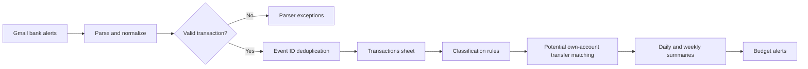

# Case study: from scattered bank alerts to a reviewable transaction ledger

## The problem

Money moves across multiple accounts, notifications arrive in different formats, and transfers between your own accounts can make expenditure look larger than it really is. Manual reconciliation takes attention, while duplicate alerts can distort totals.

## The workflow

The template recognizes three bank-alert sources (UBA, OPay and Wema), categorizes debit narrations using editable rules, preserves unknown categories, identifies potential transfers and writes ledger entries keyed by Event_ID. The reporting workflow produces scheduled summaries and threshold alerts.

## Reproduce safely

1. Import both sanitized JSON files from `workflows/` into your own n8n.
2. Connect private Gmail and Google Sheets credentials in n8n.
3. Create the four named tabs specified in the main README.
4. Populate rules and settings with **synthetic** sample records.
5. Test a debit, credit, duplicated notification, same-amount transaction, unknown category and malformed alert.
6. Reconcile outputs manually before using the system for real budgeting.

## Validation checklist

| Scenario | Expected behavior |
| --- | --- |
| Repeat alert with same Event_ID | Update existing ledger row instead of inserting duplicate |
| Ambiguous transfer narration | Leave category Unknown |
| Two accounts show same amount | Flag a potential match rather than automatically assuming own-account transfer |
| Unexpected message format | Send to parser exception path |
| Budget crosses configured threshold | Trigger the configured alert |
| Missing alerts | Reconciliation with original bank statements still required |

## Evidence and limits

This repository supplies importable *templates*, not connected personal banking data. The checks above are expected behaviors to verify in a configured environment; they are not asserted production test results. Do not commit financial data or credentials.
